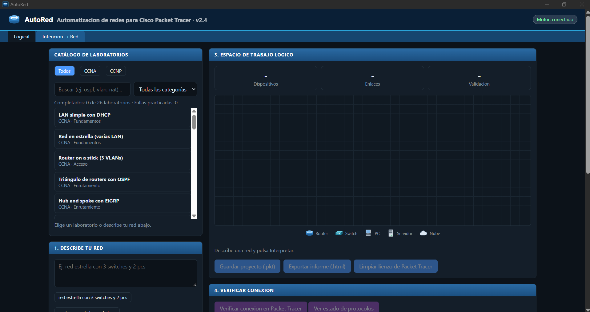
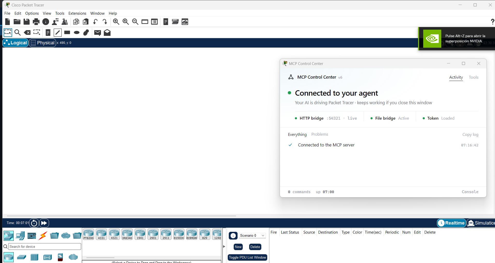
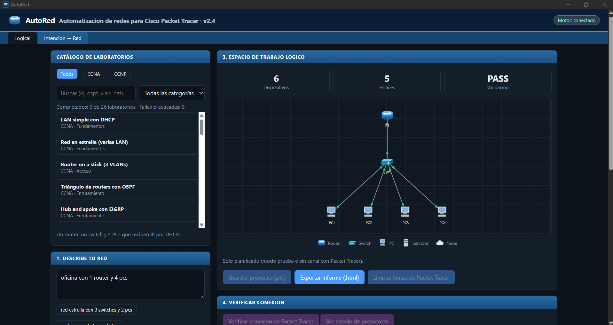
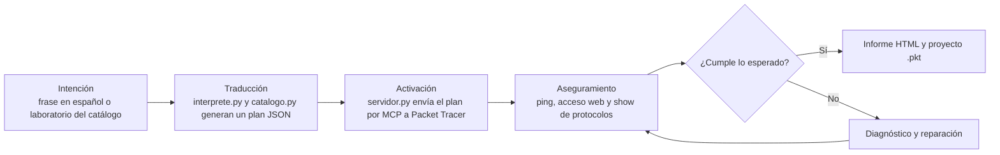

# AutoRed — Automatización de redes para Cisco Packet Tracer

AutoRed construye, configura, verifica y pone a prueba redes en Cisco Packet Tracer a partir de una **intención escrita en español** o de un **catálogo de laboratorios CCNA/CCNP**: el usuario describe qué red necesita y AutoRed la despliega y comprueba que funciona como se pidió.

## Demostración

<!-- VIDEO: en github.com, edita este archivo y arrastra aquí tu video .mp4 (máx. 10 MB). Borra esta línea después. -->

| Interfaz | Red en Packet Tracer | Verificación |
|---|---|---|
|  |  |  |

## 1. Resumen

| Dato | Valor |
|---|---|
| Entradas del catálogo | 34 (26 laboratorios completos y 8 plantillas rápidas) |
| Laboratorios por nivel | 18 CCNA y 8 CCNP |
| Prácticas de falla (inyectar, diagnosticar, reparar) | 25 |
| Pruebas automáticas (sin Packet Tracer) | 25, todas correctas |
| Autoverificación en vivo (Packet Tracer 9.0.1) | 26 de 26 laboratorios construidos; 113 de 115 pruebas en la primera corrida; las dos restantes (HSRP y CDP) se corrigieron y se confirmaron en una nueva corrida |

## 2. Metodología

El flujo sigue el ciclo de las redes basadas en intención: intención → traducción → activación → aseguramiento.



### Relación con el módulo 14 (Automatización de la red)

| Tema del módulo | Dónde está en AutoRed |
|---|---|
| Formatos de datos | El plan de red (dispositivos, enlaces, IP, protocolos y CLI) es un documento **JSON**. |
| APIs | API **REST** local (Flask) entre la interfaz y el servidor, y protocolo **MCP (JSON-RPC 2.0)** entre el servidor y el motor que controla Packet Tracer. |
| Herramientas de configuración | Las configuraciones IOS de cada equipo se **generan** a partir del plan y se envían por el canal de scripting de Packet Tracer. |
| Redes basadas en intención (IBN) | Verificación de conectividad y de estado de protocolos, con diagnóstico y práctica de fallas. |

## 3. Arquitectura

```
Interfaz (static/autored.html) --REST/JSON--> servidor.py (Flask) --MCP/JSON-RPC--> motor packet-tracer-mcp --> Cisco Packet Tracer
        ^                                        |  interprete.py (español -> parámetros)
        |                                        |  catalogo.py   (laboratorios, fallas, pruebas)
        +------------------ resultados ----------+
```

## 4. Estructura del repositorio

```
autored-packet-tracer/
├── README.md
├── .gitignore
├── requirements.txt
├── pyproject.toml
├── AutoRed.pyw                   # lanzador: ventana única de la aplicación
├── servidor.py                   # servidor Flask y puente con el motor MCP
├── catalogo.py                   # laboratorios, fallas y comprobaciones
├── interprete.py                 # español -> parámetros
├── test_autored.py               # pruebas automáticas
├── autored.ico
├── crear_acceso_directo.bat      # acceso directo en el escritorio
├── crear_acceso_directo.ps1
├── static/
│   └── autored.html              # interfaz
└── docs/                         # capturas de la demostración
```

## 5. Archivos principales

| Archivo | Qué hace |
|---|---|
| `AutoRed.pyw` | Arranca el servidor y abre la interfaz en una ventana propia; al cerrarla, detiene todo. |
| `servidor.py` | API REST, puente con el motor MCP, verificación, prácticas de falla, autoverificación e informe. |
| `catalogo.py` | 26 laboratorios y 8 plantillas, con sus pruebas, comprobaciones de estado y fallas. |
| `interprete.py` | Intérprete de frases en español: tolera tildes, errores de tecleo y jerga. |
| `test_autored.py` | 25 pruebas: coherencia de IP, puertos, equipos y expresiones; lógica de medición y autoverificación. |

## 6. Cómo reproducirlo

**Requisitos:** Windows, Python 3.12, Google Chrome o Microsoft Edge, y Cisco Packet Tracer 9.0.1 con el módulo **MCP Control Center** activado (Extensions → Scripting → Configure PT Script Modules). La primera vez, `uvx` descarga el motor `packet-tracer-mcp`.

```powershell
git clone https://github.com/josephemmanuelbernalesflores-sys/autored-packet-tracer.git
cd autored-packet-tracer
py -3.12 -m pip install -r requirements.txt
py -3.12 -m unittest test_autored -v      # 25 pruebas, no necesitan Packet Tracer
py -3.12 AutoRed.pyw                      # con Packet Tracer abierto y el lienzo vacío
```

Uso: escribir una frase (por ejemplo `red estrella con 3 switches y 2 pcs`) o elegir un laboratorio del catálogo → **Construir** → **Verificar conexión** → **Ver estado de protocolos** → practicar con **Inyectar falla**, **Diagnosticar** y **Reparar**.

## 7. Alcance y supuestos de diseño

- El catálogo cubre los temas que Packet Tracer simula; MPLS y SD-WAN quedan fuera por el soporte del propio simulador.
- El intérprete se basa en reglas: reconoce frases comunes con vocabulario de redes y avisa cuando una frase no contiene topología, equipos ni cantidades. El catálogo permite elegir un laboratorio sin escribir.
- Las comprobaciones de estado leen la salida de los comandos `show` de Packet Tracer; sus expresiones regulares están en `catalogo.py`.
- El primer ping entre redes puede perder paquetes por ARP o convergencia de protocolos. AutoRed reintenta y clasifica cada ping como completo, correcto tras pérdida inicial o con pérdida persistente.
- AutoRed es una herramienta de estudio y práctica; no debe usarse en evaluaciones prácticas calificadas.

## 8. Trabajo futuro

- Incluir las 25 prácticas de falla en una corrida completa de la autoverificación.
- Exportar las configuraciones como playbooks de Ansible o scripts de Netmiko.
- Nuevos laboratorios: IPv6 (rutas estáticas y OSPFv3), DHCP en servidor, NTP, syslog y SSH; en CCNP, iBGP, OSPF con virtual link y route-maps.
- Que la aplicación pregunte cuando falte información en la frase, en lugar de asumir valores por defecto.

## 9. Referencias

- Cisco Networking Academy. *CCNA*, módulo 14: Automatización de la red. https://www.netacad.com
- Cisco Packet Tracer. Cisco Networking Academy.
- Mats2208. *MCP-Packet-Tracer* (paquete `packet-tracer-mcp`): servidor MCP de código abierto para controlar Packet Tracer. https://github.com/Mats2208/MCP-Packet-Tracer
- Model Context Protocol, especificación. https://modelcontextprotocol.io
- JSON-RPC 2.0 Specification. https://www.jsonrpc.org/specification
- Bray, T. (2017). *RFC 8259: The JavaScript Object Notation (JSON) Data Interchange Format*. IETF.
- Flask, documentación. https://flask.palletsprojects.com

## 10. Autor, curso y docente

- **Autor:** Joseph Emmanuel Bernales Flores (código 1332022029) — Universidad Nacional de Piura, Escuela de Ingeniería Electrónica y Telecomunicaciones, IX ciclo.
- **Curso:** Gestión de Redes (CCNA 3, módulo 14).
- **Docente:** Ing. Flores Córdova, Daniel Alonso.
- **Fecha:** noviembre de 2026.
- **Herramientas:** el código se desarrolló con la asistencia de Claude (Anthropic). El autor definió los requisitos, ejecutó la aplicación y la autoverificación en su propio Packet Tracer, reportó los fallos encontrados y validó las correcciones.
